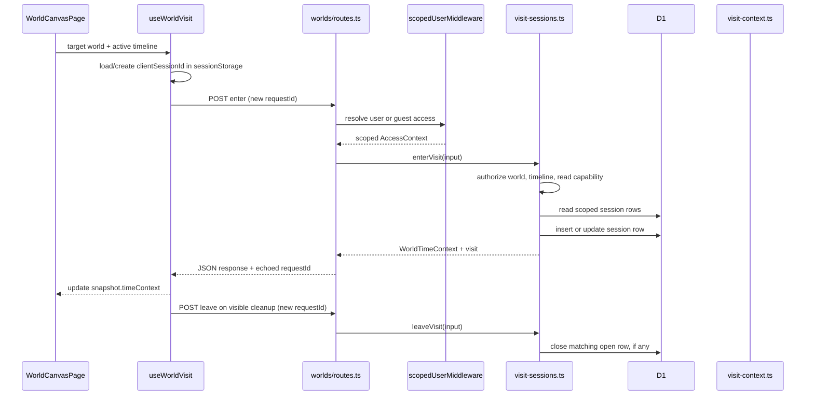

# Visit Session Grounding

## Overview

Visit tracking records whether a browser client explicitly entered or left a world timeline. It is metadata used to project a `VisitContext`; it does not advance simulation time or write world facts. The browser identifies its visit with a stable `clientSessionId`, while each enter or leave call supplies a `requestId`.

The current persistence model is a single row per principal, world, timeline, and client session. That row remembers only its latest `requestId`. This supports recognizing an immediate repeat of the latest enter request, but it is not a durable request journal and does not make arbitrary old retries safe. The storage and projection are separate from the user-only `worldVisits` watermark used to remember which return-history events were seen.

## Key Concepts

- **Principal scope:** A user is keyed as `user:<userId>` and a guest as `guest:<guestSessionId>`. A browser-side client session can therefore have distinct database rows under user and guest identities.
- **Client session:** `clientSessionId` identifies one browser session for one world and timeline. The schema enforces uniqueness across `(principalKey, worldId, timelineId, clientSessionId)`.
- **Request marker:** `lastRequestId` is stored on the session row and overwritten by a later enter or leave mutation. There is no separate row per request, operation type, input hash, or saved response.
- **Visit projection:** `VisitContext` contains `phase`, `sessionId`, `enteredSimTime`, `previousExitedSimTime`, and `hasValidPreviousWatermark`. `phase` is one of `first_visit`, `returning`, or `unknown`.
- **Seen watermark:** `worldVisits` is user/timeline scoped. A saved row is enough to make the visit projection returning, even when there is no open visit session. Guests do not read this watermark.
- **Time context:** `WorldTimeContext` combines current world/timeline state, capabilities, time zone, and visit projection. The visit endpoints return this object with the request ID echoed.

## How It Works

`WorldCanvasPage` in `web/src/pages/WorldCanvasPage.tsx` enables `useWorldVisit` only for an interactive loaded world with an active timeline. Read-only targets do not enter. In `web/src/world/useWorldVisit.ts`, `clientSessionId` is stored under `possibility:visit:<worldId>:<timelineId>` in `sessionStorage`; if storage access fails, the hook falls back to `<worldId>:<timelineId>`. Each effect run creates a fresh enter `requestId`. Cleanup creates a fresh leave ID; if an enter finishes after cleanup while the document is visible, the hook also sends leave. These calls are fire-and-forget during cleanup.

`web/src/api/client.ts` sends the three IDs as JSON to `POST /api/worlds/:id/visits/enter` and `.../leave`. The route requires string values, trims `clientSessionId` and `requestId`, and lets the service enforce their 200-character limits. `timelineId` is required as a string and is checked against the world in the service authorization step.

The route's `worldAccess` middleware calls `resolveAccessContext` through `scopedUserMiddleware`. A guest token takes precedence over a Bearer token when both are present. A guest is confined to its own sandbox world and the exact visit-route allowlist; a different world or disallowed path returns 404. Active guest access also renews guest-session and sandbox expiry before the handler runs. The service then derives the principal and calls `readWorldTimeContext`, which checks that the user owns the world or that the guest's owner and sandbox match, and that the requested timeline belongs to that world. The service additionally requires the resulting `read` capability. These checks happen before visit-session rows are read.

`enterVisit` loads all rows for the scoped principal/world/timeline, ordered by `updatedAt` descending, then looks for the supplied `clientSessionId`. If that row's `lastRequestId` equals the incoming ID, it returns early after reading the current visit projection. Otherwise it reopens or updates the existing row with current `simNow`, or inserts a new row with a server-generated session ID. The unique client-session index plus `ON CONFLICT DO NOTHING` and a reread handle a concurrent first insert by using the winning row. The database read and subsequent mutation are separate operations.

`leaveVisit` performs the same authorization and session lookup. If no matching row exists, it returns the generic current projection and records no request ID. If a matching row is open and its marker differs from the incoming ID, it closes the row, stores timeline `simNow` as `exitedSimTime`, and stores wall time as `exitedAt`. It rereads that row for the response. A closed row, or an open row whose `lastRequestId` already equals the leave ID, is not mutated.

For ordinary reads, `readVisitContext` loads sessions for the same principal/world/timeline and, for users, the `worldVisits` watermark. `projectVisitContext` selects the explicitly requested session when given one; otherwise it selects the first open row from the `updatedAt` ordering. An open session is `first_visit` without an exited-session or seen watermark and `returning` with one. With no open session, an exited session or user watermark yields `returning`; otherwise the projection is `unknown`. The projection does not create a session or update the watermark.

## Where Things Live

- `web/src/pages/WorldCanvasPage.tsx`: decides whether the current canvas target is eligible for visit tracking and applies returned context.
- `web/src/world/useWorldVisit.ts`: creates/reuses browser IDs and manages enter/leave lifecycle calls.
- `web/src/api/client.ts`: visit endpoint request types and POST methods.
- `api/src/access/scoped-user-middleware.ts` and `api/src/access/middleware.ts`: resolve and constrain user/guest access; `api/src/access/types.ts` defines the access variants.
- `api/src/worlds/routes.ts`: parses visit payloads and maps service errors to HTTP responses. Its `GET /api/worlds` path also projects owned timeline contexts for the world list.
- `api/src/life/visit-sessions.ts`: authorization, visit-row reads and mutations, and mutation response assembly.
- `api/src/life/visit-context.ts`: read-only projection from session rows and `worldVisits` watermark.
- `api/src/worlds/time-context.ts`: checks world/timeline access and assembles `WorldTimeContext`.
- `api/src/db/schema.ts` and `api/drizzle/0042_time_status_semantics.sql`: session and watermark schema; the latter creates the three visit-session indexes.
- `packages/world-contract/src/index.ts`: `VisitContext` and `WorldTimeContext` response shapes.
- `api/src/life/routes.ts`: `POST /worlds/:id/return/seen` advances the user-only `worldVisits` watermark.

## Gotchas

- `requestId` is only compared with the row's latest marker. After a later operation overwrites it, an older ID is indistinguishable from a new request and can mutate the row again. A missing-session leave stores no marker at all. The ID also does not encode whether the operation was enter or leave: reusing the enter ID for leave can make leave skip closing the open row.
- Enter replay is recognized only when its ID is still the row's latest ID. A different ID on an existing session updates entry timestamps, even when the session is already open. Reopening a closed row does not clear its previous exit fields.
- The first-insert conflict handling protects the unique client-session row, but does not persist a losing request's ID. Existing-row enter updates are by row ID; leave updates are conditional on `status = 'open'`, not on a request version. Concurrent enter/leave calls can race, with the last database write determining the row.
- A leave for an unknown `clientSessionId` calls `readVisitContext` without a session ID. That projection can return another open client session for the same principal/world/timeline, but it does not close that other session.
- The current worktree has an uncommitted `visit-context.ts` change: when the selected current row itself has `exitedAt`, it can serve as the previous watermark if there is no other exited row. This preserves `returning` for a closed selected session. There is also an uncommitted `worlds/routes.ts` change that batches owned-world context reads for `GET /api/worlds`; it does not change enter/leave mutation behavior.
- `api/drizzle/0042_time_status_semantics.sql` creates the visit-session table, while `api/drizzle/meta/_journal.json` currently ends at `0041_message_provenance`. Wrangler and the test DB load checked-in SQL files from `api/drizzle`; schema changes should account for the journal as well as the SQL migration.
- The service itself does not advance simulation time, write facts, or update `worldVisits`. Authorization of an active guest request can still renew guest expiry before service execution.

The related test source covers first entry, immediate enter replay, leave then re-enter, read-only projection, and foreign-world authorization. It does not cover stale request-ID replay or overlapping visit calls. No tests or builds were run for this grounding pass.
