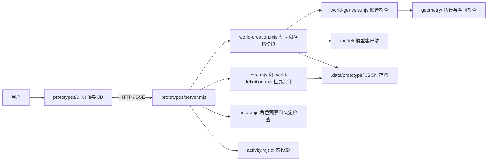
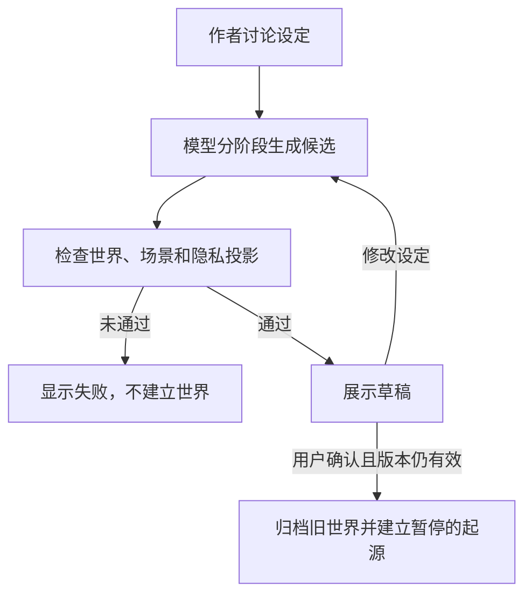

# 当前实现地图

核对日期：2026-10-28。本页概括当前工作树中的代码边界，不代表已完成产品架构或本次运行验证。目标设计见 [架构方案](design/2026-10-27-target-architecture.md)，进度和历史证据见 [工作计划](PLAN.md)。

## 主原型的运行路径

图是主要路径的概览，不是完整依赖图。服务使用 Node.js 内置 HTTP，网页使用 Three.js；依赖声明见 [原型 package.json](../prototypes/package.json)。本机启动入口与使用方式见 [主原型说明](../prototypes/README.md)。

| 关注点 | 源码与边界 |
| --- | --- |
| 创世 | [world-creation.mjs](../prototypes/world-creation.mjs) 管理对话、候选与确认；[genesis-records.mjs](../prototypes/genesis-records.mjs) 解析分阶段生成结果；[world-genesis.mjs](../prototypes/world-genesis.mjs) 检查候选、空间和部分隐私泄漏。失败不能用固定样例冒充模型结果。 |
| 状态与角色 | [core.mjs](../prototypes/core.mjs) 管理模拟与保存；[world-definition.mjs](../prototypes/world-definition.mjs) 实现有限规则和观察；[actor.mjs](../prototypes/actor.mjs) 构造角色观察并检查决定。 |
| 展示与动态 | [server.mjs](../prototypes/server.mjs) 提供页面、API 和事件流；[activity.mjs](../prototypes/activity.mjs) 投影动态；[ui/](../prototypes/ui) 和 [geometry/](../prototypes/geometry) 负责画面与场景。 |
| 数据 | 当前世界、创世草稿和世界快照默认位于 `.data/prototype/`；不要把这些本机数据当成仓库夹具。持久化详情见[原型说明](../prototypes/README.md#代码和保存)。 |
| 验证 | [verify.mjs](../prototypes/verify.mjs) 编排离线检查；[tests/](../prototypes/tests) 与 [fixtures/](../prototypes/fixtures) 包含回归检查及样例。[浏览器工作流](../.github/workflows/prototype-preview.yml) 单独运行；定义存在不代表已执行。 |

角色级可见性、有限资源和离散行动已有实现；长期相关性记忆、反思、多线分岔与任意物理仍不是已验证的完整能力。隐私审计不能证明自然语言及后续模型推理没有泄漏。准确的验证记录和待办见 [工作计划](PLAN.md)。

## 独立实验

[Minecraft 式社会实验](../experiments/minecraft-societies/README.md) 使用独立的 Luanti 运行时和 Lua agent，不接入主原型。M0 使用确定性策略，尚未接入 LLM；结果与环境选型的未决项见实验说明和计划。

| 边界 | 主原型 | 独立实验 |
| --- | --- | --- |
| 入口 | [prototypes/server.mjs](../prototypes/server.mjs) | [agent/run.sh](../experiments/minecraft-societies/agent/run.sh) 启动实验夹具 |
| 依赖与数据 | [prototypes/package.json](../prototypes/package.json)；本机 `.data/prototype/` | [runtime/bootstrap.sh](../experiments/minecraft-societies/runtime/bootstrap.sh) 物化 Luanti；`.runtime/` 和生成的实验世界各自被忽略 |
| 检查 | [prototypes/verify.mjs](../prototypes/verify.mjs) 与[浏览器工作流](../.github/workflows/prototype-preview.yml) | [独立语法工作流](../.github/workflows/minecraft-societies.yml)，尚未云端运行；[M0 证据](../experiments/minecraft-societies/agent/evidence/m0-2026-10-27.md)来自此前本机实验 |
| 生命周期 | 项目指定的唯一持续迭代原型 | 分开研究；环境选型和指标待定 |

[项目指令](../AGENTS.md)明确规定这两个目录及其边界；这里的 `prototypes/` 是持续运行的主原型，不按一次性设计草图的分支约定迁移。

## 目标、实现与证据

状态以当前源码与列出的证据为依据，2026-10-28 核对；历史测试记录不等于本次重新运行所有场景。

| 产品目标 | 现有实现和证据 | 状态与缺口 |
| --- | --- | --- |
| [文本创世与确认](intent.md#7-创世与-3d) | [world-creation.mjs](../prototypes/world-creation.mjs) 分阶段调用并检查候选；[dialogue-flow.test.mjs](../prototypes/tests/dialogue-flow.test.mjs) 覆盖确认和失败。 | 部分实现；真实模型质量和自然语言隐私仍需更多样例。 |
| [状态、演化与后果](intent.md#4-自主角色环境后果与验证) | [world-definition.mjs](../prototypes/world-definition.mjs) 执行有限资源与行动规则；[conditional-world.test.mjs](../prototypes/tests/conditional-world.test.mjs) 检查条件和后果。 | 部分实现；不代表任意物理或完整小说因果。 |
| [角色认知与记忆](intent.md#6-主观记忆) | [actor.mjs](../prototypes/actor.mjs) 投影个人观察；[red-headed-league.test.mjs](../prototypes/tests/red-headed-league.test.mjs) 检查信息隔离。 | 部分实现；长期检索、反思和分岔继承尚未完成或验证。 |
| [运行与恢复](intent.md#5-持续时间运行与恢复) | [core.mjs](../prototypes/core.mjs) 保存状态；[dialogue-flow.test.mjs](../prototypes/tests/dialogue-flow.test.mjs) 与 [observe-experience.mjs](../prototypes/tests/observe-experience.mjs) 检查部分运行和恢复行为。 | 部分实现；长期容量和断电耐久性尚未验证。 |
| [实时 3D](intent.md#7-创世与-3d) | [geometry/](../prototypes/geometry/) 编译场景；[generated-geometry.test.mjs](../prototypes/tests/generated-geometry.test.mjs) 检查有限几何。 | 部分实现；视觉质量、目标设备性能和复杂几何不能由离线测试证明。 |
| [分岔与在场](intent.md#9-在场与平行世界) | [目标方案](design/2026-10-27-target-architecture.md#5-创世附身对话与分岔) 描述预期。 | 规划中；完整平行世界、附身和继承未实现或未验证。 |

检查入口、既有运行记录和尚待进行的浏览器验收详见[工作计划](PLAN.md)。

## 创世的确认边界（当前实现）

实际流程和失败处理以 [world-creation.mjs](../prototypes/world-creation.mjs) 与 [world-genesis.mjs](../prototypes/world-genesis.mjs) 为准。隐私检查只覆盖程序能检查到的部分，不能证明语义安全。
